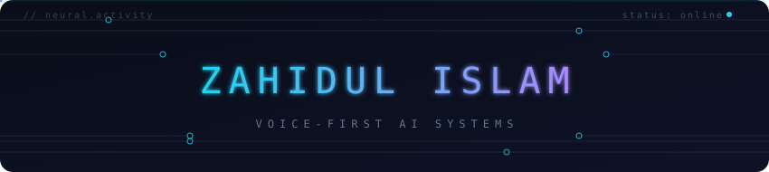

  

  <picture>
    <source media="(prefers-color-scheme: dark)" srcset="assets/typing-dark.svg">
    
  </picture>

  <picture>
    <source media="(prefers-color-scheme: dark)" srcset="assets/divider-dark.svg">
    
  </picture>

I build voice-first AI systems end to end: wake-word models that run on a
phone, language models trained from scratch, and the agents wired around them.

## Now

- Contributing to open-source AI/ML projects — type systems, training internals, inference paths
- Pretraining **NOESIS**, my own LLM — a 125M-parameter decoder-only transformer (RoPE · RMSNorm · SwiGLU · GQA) built from zero: own tokenizer, own trainer, own quantizer
- Building **Atelier** — a private chat stack: quantized LLM engines, Kokoro-82M speech synthesis, SDXL image generation, wired through async job queues

## Selected work

| | |
|---|---|
| [**NOESIS**](https://github.com/zahidSkywalker/noesis) | A language model from scratch — byte-level BPE tokenizer, RoPE/RMSNorm/SwiGLU/GQA transformer, int8 quantizer, full training pipeline. Zero pretrained weights, zero external APIs. Trains on a single T4 (4 vCPU, ~30GB RAM); inference runs on 4 CPU cores |
| [**SalonFlow**](https://github.com/zahidSkywalker/salonflow) | Salon & barber booking + POS — guest storefront, booking without an account, receipts |
| [**NanoWakeWord**](https://github.com/zahidSkywalker/NanoWakeWord) | Personal offline wake-word assistant for iOS — fully on-device |
| [**IdeaPitch**](https://github.com/zahidSkywalker/ideapitch) | Turns startup ideas into investor-ready pitch decks |
| [**NCTB Physics Lab**](https://github.com/zahidSkywalker/nctb-physics-lab) | Interactive 3D physics simulations for the national curriculum |
| [**Bot Gateway**](https://github.com/zahidSkywalker/bot-gateway) | Token-authenticated WebSocket + REST gateway for chat bots |
| [**Echo Bridge**](https://github.com/zahidSkywalker/echo-bridge) | Discord ⇄ web relay for chatbots |

## Stack

  
   
  

<em>Swift, when a wake word needs it.</em>

  

Everything is sized for real hardware: training fits a single T4 (4 vCPU, ~30GB
RAM), inference runs on 4 CPU cores, quantized weights ship in ~150MB.

  <picture>
    <source media="(prefers-color-scheme: dark)" srcset="assets/divider-dark.svg">
    
  </picture>

  <a href="mailto:zahidul.islam@outlook.com">zahidul.islam@outlook.com</a> ·
  <a href="https://discord.com/users/578598045004988416">Discord</a>

